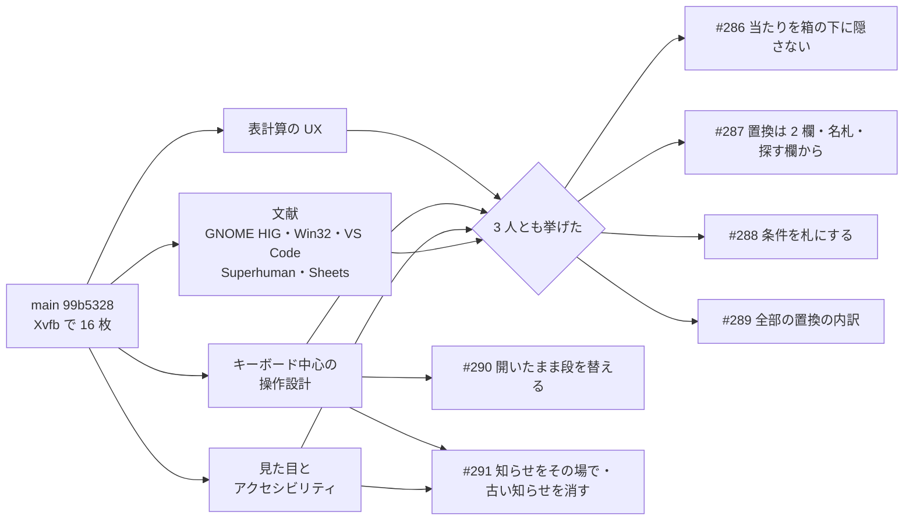

# 検索・置換・コマンドパレットの使い勝手の見直し — 専門家ペルソナと文献（2026-11-09）

> GitHub Issue #285。施主の依頼（2026-11-09）：「Ctrl+P から始まるコマンド系で、検索とか置換とかが使い勝手が本当にいいか、デザイン系や GUI の専門家ペルソナにスクリーンショットや条件を伝えて相談して」「専門家ペルソナに従って、僕に質問しないで」。
> 施主は外出中。**判断は専門家ペルソナの推しで作り、施主の確認を待つ**（2026-11-07 の ADR 0030 の第 7 節と同じ扱い）。
> 起点は `main` `99b5328`。画面は Xvfb（1024×640・既定の配色）で撮った。

## 1. 要約

| 改善 | 表計算の UX | 操作設計 | 見た目 | 文献 | Issue |
| --- | --- | --- | --- | --- | --- |
| 当たったセルが箱に隠れない | 中 | 高 | 高 | VS Code `addExtraSpaceOnTop`・GNOME Text Editor #346 | #286 |
| 置換の 2 欄・名札・Ctrl+H は探す欄から | 高 | 中 | 高 | VS Code の 2 欄・Excel | #287 |
| 条件をオンとオフの札に | 中 | 中 | 中 | VS Code の `Aa` `ab` `.*` | #288 |
| 全部の置換の内訳（前→後） | **高・1 位** | **高・1 位** | 高 | Excel の部分一致の事故（datacamp） | #289 |
| 段の行き来（Ctrl+F/H/G/Shift+P） | — | 中 | — | Superhuman「同じキーで閉じる」 | #290 |
| 0 件の理由をその場に・古い知らせ | 低 | 低 | 低〜中 | GNOME HIG「No results をその場で」 | #291 |
| 件数（n / m） | — | 中 | — | VS Code `{0} of {1}`・GNOME HIG | 後（下の第 5 節） |
| 列や範囲に限る既定 | 中 | — | — | VS Code `autoFindInSelection` | 後（Alt+S は既にある） |
| パレットを漢字・かなで引く | 低 | 低 | — | Superhuman「別名」 | 後 |
| 色の役割（完了は緑・誤りは赤） | — | — | 中 | — | 後 |

## 2. 見せた画面と条件

資料（専門家に渡した文）の要点：製品の目的・想定の利用者（Excel に慣れた日本の事務と、エンジニア）・ADR 0030 の作り・制約（値は文字列・依存は許可制・UI に判断を置かない・Windows が主・GB 級のファイル）。

撮った画面（`drive.sh` で Xvfb の窓へ `xdotool key` を送り、`import -window root` で撮った。使い捨ての道具なのでリポジトリには置かない）：

| 名前 | 何をしたか | 見えたこと |
| --- | --- | --- |
| base-01palette | Ctrl+Shift+P | 43 の操作。右にキー |
| f3-20 / f3-21 | パレットで `find`・`kensaku` | 4/43・1/43。ローマ字で引ける |
| f2-05typing | Ctrl+F で `2026/0` | 打つたびに当たりが黄。箱の下の 2〜4 行目の当たりは見えない |
| f2-07enter2 | Enter 2 回 | **カーソルの 3 行 8 列が箱の下**。行の番号の色しか見えない |
| f3-22 | Alt+C・Alt+W | 条件の文が「区別する」「セル全体」に変わるだけ |
| f4-31tab | Ctrl+H で `980` → Tab | 箱の中身が置き換える欄に入れ替わり、探す欄は灰色の 1 行に |
| f4-33count | Alt+A | 「186 セルを置き換えます」。**部分一致なので 1980 も当たっている** |
| f4-34done | Enter | **1980 が 1990 になった** |
| f4-36reopen | Esc → Ctrl+H | 置き換える欄から始まる。箱の `990` がどちらの文字か名札が無い |
| f3-25 | 0 件で Alt+A | 「置き換えませんでした（訳は下の状態の行）」 |
| f3-28 | Ctrl+G | 前の「見つかりませんでした」が状態の行に残る |

自分で見つけて、専門家に渡す前に確かめたこと：

- 置換の段で Ctrl+Shift+P を押すとパレットが閉じ、続けて打った `find` がセルの編集に入った（f2-12）。字が表に入るので、段の行き来（#290）は使い勝手だけでなく事故の芽でもある。

## 3. 専門家の答え（要約）

### 表計算の UX（Excel・Sheets・Calc・Modern CSV・EmEditor・日本の事務の観察）

- 高：全部の置換で 1980 まで変わる。確かめが件数だけ。高：箱が 1 つで今どちらの欄か名札が無い。高：置き換える欄が空だと当たった所が消えるのに、注意は案内文だけ
- 推し 1：確かめに「980→990 120 セル／1980→1990 66 セル」のように前と後の組を上位 5 件。推し 2：欄を 2 つ縦に・名札・Ctrl+H は探す欄から・前の文字は全部選んで（Excel と同じ）。推し 3：列や範囲を選んでいたら最初からその範囲。推し 6：置き換える欄が空のときは赤で「当たった所を消します」
- 変えない：数えてから Enter の 2 段・Ctrl+Z 1 回・打つたびの黄・F3・Ctrl+G の `1200,3`

### キーボード中心の操作設計（VS Code・Sublime・JetBrains・Zed・Raycast・Superhuman）

- 推し 1：確かめに「セル全体の一致 120・部分一致 66」の内訳と、その場で Alt+W で数え直せる案内。推し 2：当たりが箱と重なるなら表を送り、足りなければ箱を窓の下へ。推し 3：条件は欄の右端の札（`Aa`・`全体`・`.*`・`全半`・`かな`）。推し 4：2 欄・探す欄から・全部選んで。推し 5：「画面内 7 件」と裏で数えている途中の「≥1,240…」。推し 6：開いている間の Ctrl+F/G/H は閉じずに段を替え、打った字は残す。推し 7：最近使った 5 件。推し 8：Ctrl+G に「1〜301 行・9 列」
- 変えない：浮いた箱 1 つ・Enter / Shift+Enter / F3・ローマ字のあいまい検索・右のキー

### 見た目とアクセシビリティ（情報の階層・WCAG・日本語の文言・高齢の事務と弱視の利用者）

- 高：名札が無い。高：確かめが件数だけ。高：当たりが箱の下。中：条件の言い方の向きが揃わない（「区別しない」と「区別する」）。中：橙をフォーカス・選択・確認・完了・0 件のすべてに使う。中：灰色の案内が薄く長い
- 推し 1：欄の左に名札（「探す｜」「置換｜」）。推し 4：条件はチップ（オンは塗り＋✓・オフは枠）で名前を固定。推し 5：完了は緑＋✓・0 件と誤りは赤＋！。推し 6：0 件の理由をその場に（「当たりがありません（セル全体・大小区別がオン）」）。推し 7：今の当たりは濃い枠。推し 8：灰色の字を 4.5:1 以上に
- 変えない：右に揃えたキーと「4 / 43」・ローマ字・「探す（見えている値で）」・数えてからの確かめ・二段の黄

## 4. 文献（出典を確かめたものだけ）

- GNOME HIG（search パターン）：打つたびに結果を更新し、集まった順に見せる。一致が無ければその場で「No results」。<https://developer.gnome.org/hig/patterns/nav/search.html>
- Win32 の検索と置換の共通の画面はモードレス（文書と行き来できる）。<https://learn.microsoft.com/en-us/windows/win32/dlgbox/find-and-replace-dialog-boxes>
- VS Code：切り替えは大文字小文字・単語・正規表現の 3 つの札、置換の欄の側に Preserve case。選択範囲の中は Alt+L。件数の文言は `{0} of {1}`・一致が無ければ `No results`（`findWidget.ts`）。`editor.find.addExtraSpaceOnTop` は 1 行目の上に窓の高さの空きを足し、1 行目の当たりが窓に隠れないようにする。<https://code.visualstudio.com/docs/editing/codebasics>・<https://github.com/microsoft/vscode/blob/main/src/vs/editor/contrib/find/browser/findWidget.ts>
- GNOME Text Editor の Issue #346：1 行目の当たりが検索の窓の後ろに隠れる（未解決）。<https://gitlab.gnome.org/GNOME/gnome-text-editor/-/issues/346>
- Superhuman：どこでも同じキーで開き、**同じキーでもう一度押すと閉じる**。命令ごとに別名を持たせ、どの別名に当たったかを見せる。キーを並べて覚えてもらう。<https://blog.superhuman.com/how-to-build-a-remarkable-command-palette/>
- Google Sheets：セル全体の一致は既定でオフ。<https://support.google.com/docs/answer/62754>
- Excel の部分一致の事故（`cat` を置き換えると `catalog` も変わる・すべて置換は 1 件ずつ確かめない）：二次資料 <https://www.datacamp.com/tutorial/find-and-replace-in-excel>

Fluent（Windows 11）・Apple HIG・NN/g に、検索と置換に絞った指針は見つからなかった（調べて無かった、と書く）。

## 5. 決めたこと（専門家の推し）と残したこと

作る順は、事故を止める物と小さな物を先に：#286 → #290 → #287 → #288 → #291 → #289。

| # | 推し（作る形） | ほかの案（捨てていない） |
| --- | --- | --- |
| #286 | 当たったセルが箱と重なるなら表を送って箱の下へ出す。表の先頭で送れなければ箱を窓の下へ寄せる | VS Code と同じく表の上に空きを足す（行の番号と見出しの固定の作りに手が入る）／箱を右上の小さな帯にする |
| #287 | 欄を 2 つ縦に並べて名札。Ctrl+H はいつも探す欄から、前の文字は全部選んだ状態 | 箱 1 つのまま名札だけ足す |
| #288 | 名前を固定した札を並べ、オンは塗り、オフは枠 | 欄の右端に `Aa` などの短い札（VS Code）。日本語の利用者には記号だけでは伝わりにくいので名前を書く |
| #290 | 開いている段と違うキーは閉じずに段を替える。同じキーは閉じる（Superhuman） | VS Code の接頭辞（`>` `:`）で段を替える |
| #291 | 0 件の理由（オンの条件）をその場に。欄を開いたら古い知らせを消す | — |
| #289 | 確かめに、前→後の値の組を件数の多い順に数件と、部分一致なら添え書き。置き換える欄が空なら「当たった所を消します」 | 「セル全体 n・部分 m」の内訳だけ（操作設計の推し）／プレビューの表（ADR 0030 でフェーズ 2） |

後に回した物（理由）：

- **件数 n / m**：GB 級のファイルでは全部を数えると待つ（ADR 0030 の決定 4）。「画面内 n 件」と裏の数え（中止できる）は別の Issue で ADR 0030 の追記として考える
- **色の役割（完了は緑・誤りは赤）**：125 配色の導出とコントラストの試験に手が入る。札と名札が入った後で見え方を測ってから
- **パレットを漢字・かなで引く**：IME の確定をパレットの欄が受けるかを先に確かめる
- **列や範囲を選んでいたら最初からその範囲**：Alt+S（範囲）は既にある。既定を変えるのは事故の向きが逆になる（選んだまま探して見つからない）ので、施主の判断を待つ

## 6. 作った物（2026-11-09 の日中・積んだ PR）

main にはまだ入っていない（自動のマージが止められたので、施主のレビューを待つ）。マージの順は下の表の上から。

| PR | Issue | 何を | 画面で確かめたこと（Xvfb） |
| --- | --- | --- | --- |
| #293 | #286 | 見つけたセルが箱の下に入れば表を送り、表の端なら箱を反対の端へ寄せる | 先頭の当たりで箱が下へ・末尾の当たりで上のまま・詳細ペインを閉じても同じ |
| #294 | #290 | 開いている間の別の段のキーは段を替え、同じ段のキーだけ閉じる | Ctrl+H → Ctrl+Shift+P → `find` がセルに入らない・Ctrl+G で段・もう一度で閉じる |
| #295 | #287 | 置換は 2 つの欄と名札「探す」「置換後」・表から Ctrl+H は探す欄から・前の文字は全部選ぶ | 選んだ `980` に `1` を打つと置き換わる |
| #296 | #288 | 条件は 5 つの札（オンは ✓・塗り・強調の縁）・押しても切り替わる | Alt+C・Alt+W で札がオンに |
| #297 | #289 | 全部の置換の確かめに内訳 | `“980”→“990” 74 セル · “29800”→“29900” 61 セル` |
| #298 | #291 | 見つからない・置き換えなかったことを欄の中で、オンの条件を添えて。開き直せば古い知らせを消す | 「見つかりません（オン: セル全体）」・Ctrl+G で状態の行が空く |
| #301 | #299 | 内訳はセル全体の組と一部だけの組に分け、一部だけを強調の色で必ず出す・確かめの間の条件の切り替えで数え直す・「ひら/カタを区別」 | 「一部だけ変わる 112 セル: “29800”→“29900” など」→ Alt+W で 74 セルに数え直し |
| #302 | #300 | 箱を開いたときもカーソルを隠さない・下へ寄せた箱は状態の行の上 | 2 行 7 列にカーソルのまま Ctrl+H で箱が状態の行の上へ |

測ったこと：内訳を作る手間（release・i9-10850K）は 100 万セルで値が 10 通りなら 34 ms、100 万通り（最悪）で 222 ms。数え終えたときに 1 度だけ。

## 7. 2 巡目（直した後の画面 8 枚を同じ 3 人に見せた）

3 人とも「名札・札・その場の知らせ・段の行き来・箱をよける送り」は直ったと言った。新しく出た指摘：

| 指摘 | 表計算 | 操作設計 | 見た目 | どうしたか |
| --- | --- | --- | --- | --- |
| 内訳が多い順なので、本命の 1980→1990 が「ほか 1 通り」に埋もれる | 高 | 高 | 高 | #299 で直した（一部だけの組を分けて必ず出す） |
| 置換の段で開いた時点のカーソルが箱の下 | — | 小 | — | #300 で直した |
| 下へ寄せた箱が状態の行を覆う | 中 | 中 | 中 | #300 で直した |
| 確かめの間は札が消えるのに Alt+W の案内 | 中 | 中 | — | #299 で、確かめの間の条件の切り替えはその場で数え直すようにし、案内の文から Alt+W を外した |
| 「かなを区別」がひらがなとカタカナの区別と読めない | 低 | — | — | #299 で「ひら/カタを区別」 |
| 橙が確かめ・注意・完了・0 件すべて（完了は緑・誤りは赤） | 低 | 低 | 中 | **残した**：配色の役割を足すと 125 配色の導出とコントラストの試験に手が入る。ADR 0030 第 7 節の当たりの黄と同じ作りで足せる見込み |
| 欄の中と状態の行で知らせが二重 | — | 低 | 低 | **残した**：状態の行は欄を閉じた後（F3）の知らせの置き場でもある |
| オフの札の字と枠が薄い・選んだ文字の色が薄い | — | — | 中・低 | **残した**：配色の役割の見直しと一緒に |
| 箱が上下に跳ぶと見失う（高齢の利用者） | — | — | 中 | **残した**：跳ぶのは表の端で送れないときだけ。施主の手応えを待つ |

## 8. 続き：2 巡目の後に作った物と、3 巡目（パレットのほかの段）

2 巡目の後に作った PR（積んだ順）：

| PR | Issue | 何を |
| --- | --- | --- |
| #304 | #303 | パレットを漢字とかなで引く（名前・読み・日本語の言い換え）。main から独立 |
| #306 | #305 | 配色の役割に済んだ（緑）と注意（赤）。欄の知らせを種類で色分け（125 配色で試験） |
| #308 | #307 | Ctrl+G に表の範囲と、範囲の外の番号の注意 |
| #310 | #309 | 何も打っていない一覧の上に最近使った操作（5 つ） |

3 巡目は、Ctrl+Shift+P の操作の一覧と 2 段目（配色・文字コード・区切り・見出しの行・判別の候補・キーの一覧・このアプリについて）の 11 枚を、同じ 3 人に見せた。

| 指摘 | 表計算 | 操作設計 | 見た目 | どうしたか |
| --- | --- | --- | --- | --- |
| 読み方を試す段で、試した先頭の行が箱に隠れる（試す意味が無い） | 高 | 高 | 高 | #313（#311）：試す段は箱を窓の下へ寄せ、候補を 6 行に詰める |
| 今の配色の印が無い | 中 | 中 | 中 | #314（#312）：「今の配色 · ライト」 |
| 見出しの行の段の案内が「例: sjis, tab」（写し間違い） | 中 | 中 | 中 | #314：「行の番号で絞る（例: 2）」 |
| 文字コードの名前だけでは事務職が選べない | 中 | — | — | #314：「Windows・Excel の日本語」などの注 |
| 判別の候補の試しの案内が切れる | 低 | 中 | 中 | #314：キーを先に書き、名前の側で切れるように |
| このアプリについてが選べる一覧に見える | 低 | 低 | 低 | #314：選ぶ色を付けない |
| 配色を試しても箱が明るいまま | 中 | 中 | 中 | **残した**：箱は開いたときの配色で描く作り（試しても読めるように）。下へ寄せて表が見えるようになった（#313）ので、施主の手応えを待つ |
| 操作の一覧に区切り（移動・選ぶ・表示・読み方・列）が無い | 低 | 低 | 中 | **残した**：選びの番目と描く行の作りに手が入る。最近使った操作（#310）を先に入れた |
| 見出しの行は「2-3」と打って絞りたい | 中 | 中 | — | **残した**：絞り込みの書き方を足す。次の Issue の候補 |
| 「RFC 4180」「0% · 1 列」が事務職に通じない | 低 | — | 中 | **残した**：表示言語の文言の表（ADR 0011）と一緒に |

## 9. 4 巡目：表の画面（パレットの外）

200 行の「郵便番号,住所,金額,日付,メモ」（金額の `1,200` を引用せずに書いたので、列が 1 つ多い行がある）で、開いた直後・範囲の集計・F2 の編集・長いメモと改行・書き換えと Ctrl+W・列全体の選択の 8 枚を同じ 3 人に見せた。

| 指摘 | 表計算 | 操作設計 | 見た目 | どうしたか |
| --- | --- | --- | --- | --- |
| 列の数が見出しと違う行に印が無く、値が右へずれただけに見える | 高 | 高 | 高 | #318（#317）：行の番号を注意の色・左に帯・詳細ペインに「列の数が違う：6 列・見出しは 5 列」 |
| 集計が ¥3・1.5e3・1,200 を黙って数に読む | 高 | 高 | 中 | #320（#319）：「記号や指数を読んだ 2」を添える（読み方は Issue #41 のまま） |
| F2 の編集で狭いセルの頭が切れる（0012999 が 2999） | 中 | 中 | 高 | #322（#321）：セルを右へ広げて全体を見せる（Excel と同じ） |
| 書き換えたセルに印が無い | 中 | 中 | 中 | #324（#323）：右上に強調の色の小さな四角（保存・Undo で消える） |
| Ctrl+W が無反応 | 中 | 低 | 中 | **残した**：閉じる意図を足すと、キーの表と全部の `match` に手が入る。施主の判断（Ctrl+W を閉じるにするか） |
| 列全体を選ぶと行の帯と範囲が重なって表が一面に染まる | 低 | 中 | 中 | 次の Issue |
| 「件数 200 · 数でない 200」は文字列の列で役に立たない | — | 中 | 低 | **残した**（文字列の列の集計は「空・異なる値」など・STAT-09 と一緒に） |
| ファイル全体の壊れた行の数と「次の壊れた行へ」 | 高 | 高 | — | **残した**：VALD-01（構造の検査の一覧）で |

変えない方がよい所（3 人とも）：0012・1.5e3 を書いてあるとおりに出す・「空のセル」と「セルが無い」の区別・改行の ¶ と詳細ペイン・字数とバイト数・Excel と同じ入力と編集の作法。

## 10. 5 巡目：4 巡目で直した表の画面の確かめ

3 人とも、壊れた行の印・編集の欄を広げること・列の選択の帯は「直った」と言った。新しい指摘と扱い：

| 指摘 | 表計算 | 操作設計 | 見た目 | どうしたか |
| --- | --- | --- | --- | --- |
| 集計が壊れた行のずれた値を黙って足す（合計 30,203 は信用できない） | 高 | 高 | 高 | #330（#329）：「列の数が違う行 n を含む」を集計の頭に付け、注意の色に。合計から外すかは施主の判断 |
| 書き換えの印が小さく、カーソルと同じ橙 | 低 | 中 | 中 | #332（#331）：セルの左の 3 px の緑の帯 |
| 広げた編集の欄の右に隣の値の端がのぞく | 中 | — | — | #332：欄の右端を列の境にそろえる |
| 状態の行が長くなり、狭い窓で左右がぶつかる | — | 低 | 中 | **残した**：左の読み方は右の集計の手前で切る作り（既存） |

## 11. 自分の検証の漏れ（正直に）

積んだ PR の #301 と #306 で、1 つのファイルに主要な宣言を 2 つ置き、`make conformance` の CNF-003（RS-012）が落ちていた。ADR 0030 が調査の記録（#292）を指すので、#292 より前に積んだ枝だけでは CNF-009 も落ちる。CI（`make ci`）は conformance を走らせないので緑だった。#328（#327）で直し、以後は PR ごとに `make conformance` も走らせた。
