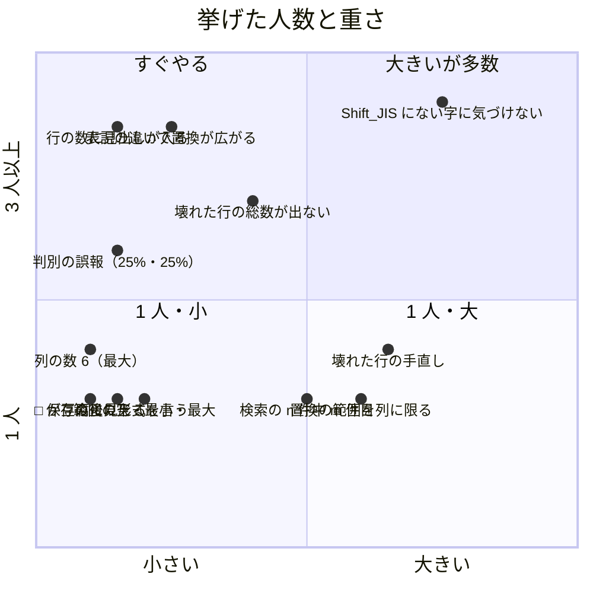

# 実際の利用者になりうる業界のペルソナ 5 人への相談と品質改善（2026-11-09）

> 施主の依頼（2026-11-09）：「今実機確認できないから、実際にユーザーになりうる業界のスペシャリストペルソナ複数に、改善点はないか相談して品質改善して」。
> 施主の実機（Windows）は使えない日。画面は Xvfb（1024×640・既定の配色）で撮り、業界ごとの見本の CSV と一緒に渡した。
> 起点は `main` `aa9d666`（0.1.0-preview.2 の準備まで）。**判断はペルソナの多数の推しで作り、施主の確認を待つ**。

## 1. 誰に、何を渡したか

| ペルソナ | 毎日の仕事 | 渡した見本（業界の形を真似て作った・実在のデータではない） |
| --- | --- | --- |
| 経理（中小企業の経理担当） | 会計ソフトの仕訳の CSV の確かめと手直し | 仕訳 400 行・Shift_JIS・CRLF・金額は `"1,234,567"`・半角カナの摘要 |
| データアナリスト（BI） | 受け取った CSV の受け入れ検査と集計 | 売上 5,000 行・UTF-8・`store_code` の先頭の 0 |
| データエンジニア（ETL） | ログの TSV を取り込む前の修理 | イベント 301 行・UTF-8（BOM）・CRLF・タブ・4 列と 6 列の壊れた行・`C:\data\x`・`"tanaka"` |
| EC の運営（モールの商品登録） | 商品 CSV の一括の直しとアップロード | 商品・Shift_JIS・JAN 13 桁・HTML の説明文・セルの中の改行 |
| 人事・総務 | 社員名簿の整形（年賀状ソフト・給与ソフトへ） | 名簿・UTF-8（BOM）・社員番号 `00001`・和暦・氏名の全角の空白 |

問いは 4 つに固定した：1. 使うか（使う・場合による・使わない）、2. 困る点（高・中・低）、3. 改善案（優先順・重さ）、4. 変えないほうがよい所。

## 2. 答えの要約

- **全員が「場合による」**。理由は共通：値を文字のまま扱う（先頭の 0・JAN・和暦・`"1,234,567"`）、触っていない行のバイト列が変わらない。ここは**全員が「変えないで」**と言った
- 使わない理由も共通：**書き出しの形（文字コード）を確かめられない**・**壊れた行を直しきれない**・**集計や整形が足りない**（並べ替え・絞り込み・列の変換は「まだ」）

## 3. 直したこと（この日・すべて main に入れた）

| Issue | 挙げた人 | 直したこと | PR |
| --- | --- | --- | --- |
| #381 | ETL・アナリスト | 判別に確信が無い知らせに、迷った 2 つの読み方の名前を出す。区切りが同じなら「タブ区切りは確か。引用の読み方が決まらない」。導線を日本語に | #382 |
| #383 | 経理・アナリスト・ETL | 状態の行を「データ 300 行（見出し 1 行）」に。見出しより多い列の行があれば「5 列（最大 6）」 | #384 |
| #385 | 経理・EC・人事 | 全部の置換の前に「表記の違う “Ｎｏ．１” などにも当たる N セル」を赤で（区別しない既定のままの事故を防ぐ） | #386 |
| #387 | 人事 | 詳細ペインに表の印の凡例（「□ 全角の空白 1」「→ タブ」「¶ 改行」） | #388 |
| #389 | アナリスト | 範囲の集計に「範囲 最小〜最大」と「空 N」 | #390 |
| #391 | アナリスト・ETL | 索引の後にファイル全体の壊れた行を裏で数え、状態の行に「列の数が違う行 N（F8）」 | #392 |
| #393 | 経理・EC・人事 | 表せない字で保存できないとき「4 行目 · 7 列目 の「𠮷」は Shift_JIS（CP932） で表せない…（この字のセル N · 直してから Ctrl+S）」 | #394 |
| #395 | （#393 の確かめで見つけた） | 詳細ペインが、Shift_JIS で必ず表せない字（絵文字・𠮷）を含む値に「4 バイト」と出さず「表せない字「😀」U+1F600 あり」 | #396 |
| #397 | EC | 保存したら「保存しました（1 セル · Shift_JIS（CP932） · カンマ区切り · CRLF のまま）」 | #398 |

確かめ方は各 PR に書いた（`make lint`・`make conformance`・`make doc-check`・`make test` と、Xvfb で業界の見本を開いて撮った画面）。**Windows の実機では見ていない**（QLT-013：施主の実機の確認を待つ）。

### 判別の「確信なし」は誤報だったか

ETL のペルソナは「きれいな TSV に誤った警告」と言ったが、測ると**迷いは本物**だった：タブ・`""` で引用符と、タブ・`\` で逃がすが同じ 255 点で、`C:\data\x` の読み方が違う。だから知らせは残し、**何と何で迷ったか**を言うようにした（#381）。点数が 255 と低いのは、壊れた行 2 つで行の形の一貫性の点（`pattern_score`）が列の数の種類の数で割られるため。判別の点の付け方は Pollock の重み付きの点（9.66）に効くので、この日は変えていない。

## 4. まだのこと（大きい・ペルソナが挙げた順）

| 挙げた人 | こと | 重さ | メモ |
| --- | --- | --- | --- |
| 経理・EC・人事 | 保存の前に、表せない字を全部一覧で見せる。文字コードを変えて保存する | 大 | 今は最初の 1 字で止まり、場所を言う（#393）。表は store にしか無い（core は no_std） |
| ETL | 壊れた行の手直し（末尾の余計なセルを消す・足りないセルを足す） | 中 | 足りないセルは今も直して足せる（#83）。余計なセルを消す道が無い |
| EC | 置換の範囲を、選んだ列に限る既定と「範囲：販売価格」の表示 | 中 | FEATURES の「検索の範囲を列や選択に限る既定」 |
| 人事・アナリスト | 検索の「n 件中 m 件目」・F8 の「1/2」 | 中 | ファイル全体を数える裏の仕事が要る（#391 の仕組みが使える） |
| アナリスト | 列の要約（値の種類の数と多い順） | 中〜大 | ROADMAP の列の要約 |
| 経理 | 2 つの列の合計と差（借方・貸方・差） | 中 | 範囲の集計を列ごとに |
| EC | 「価格を 10% 上げる」などの列の変換 | 大 | ROADMAP の列の変換 |
| ETL | 無いセルと空のセルを描き分ける | 小 | RS-004 の区別を目に見えるように |
| 人事 | 状態の行の用語（BOM・LF）に平易な注 | 小 | パレットの注と同じ形で |
| EC | Windows で探す欄の IME（日本語の置換） | 小〜中 | 実機で確かめてからリリースノートに書く |

## 5. 変えないでと言われたこと（全員）

- 値を文字のまま扱う（先頭の 0・JAN・和暦・桁区切りの金額）
- 触っていない行のバイト列が変わらない
- 全部の置換の前の内訳と、一部だけ変わるセルの赤
- 行の番号＝ファイルの物理の行（エラーの行の番号と照合できる）
- 集計の「数でない N」「記号や指数を読んだ N」
- 詳細ペインの「Shift_JIS で 56 バイト」（モールの上限の確かめにそのまま使える）
